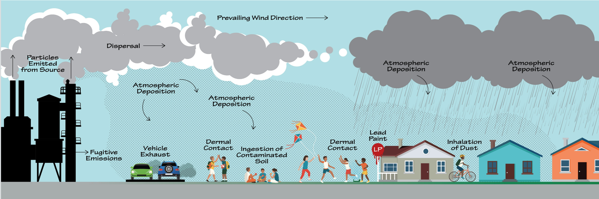

```{r}
#| label: setup
#| message: false

library(tidyverse)
library(geosphere)
set.seed(222)
theme_set(theme_bw(22))

# Approximate location of the former Exide facility (2700 S Indiana St, Vernon)
exide_lon <- -118.1923
exide_lat <- 34.0058

soil_cores <- read_csv("data/exide-soil-cores.csv") |>
  filter(pb_ppm <= 5e3) |>
  mutate(
    distance_ft = distGeo(cbind(longitude, latitude), c(exide_lon, exide_lat)) *
      3.28,
    distance_mi = distance_ft / 5280,
    bearing_deg = bearing(c(exide_lon, exide_lat), cbind(longitude, latitude))
  ) |>
  drop_na() |>
  left_join(
    read_csv("data/exide-property-covariates.csv"),
    by = "property_id"
  ) |>
  mutate(
    inside_radius = distance_mi < 1.5,
    home_age = 2026 - year_built,
    dist_to_freeway_mi = dist_to_freeway_m / 1609.3445,
    wind_direction = case_when(
      between(bearing_deg, 0, 135) ~ "Downwind",
      TRUE ~ "Upwind"
    )
  )
```

# Multiple regression

## Learning objectives

- **Visualize** data with _multiple predictors_
- **Describe** _causal relationships_ with DAGs
- **Model** _multiple predictors_ simultaneously

# Visualize data with _multiple predictors_

## So many influences!



## Pb more prevalent in _older homes_

```{r}
home_age_lm <- lm(pb_ppm ~ home_age, soil_cores)
```

Soil Pb increases by `r round(coef(home_age_lm)[2] * 10, 1)` ppm per decade of home age

```{r}
#| fig-width: 6
#| fig-align: center

ggplot(
  soil_cores,
  aes(x = home_age, y = pb_ppm)
) +
  geom_point(shape = 21, alpha = 0.25, fill = "grey80") +
  geom_smooth(method = "lm", se = FALSE, color = "cornflowerblue") +
  labs(x = "Home age (years)", y = "Soil Pb (ppm)")
```

## Pb more prevalent _closer to freeways_

```{r}
dist_freeway_lm <- lm(pb_ppm ~ dist_to_freeway_mi, soil_cores)
```

Soil Pb decreases by `r abs(round(coef(dist_freeway_lm)[2], 1))` ppm per mile from freeway

```{r}
#| fig-width: 6
#| fig-align: center

ggplot(
  soil_cores,
  aes(x = dist_to_freeway_mi, y = pb_ppm)
) +
  geom_point(shape = 21, alpha = 0.25, fill = "grey80") +
  geom_smooth(method = "lm", se = FALSE, color = "cornflowerblue") +
  labs(x = "Distance to freeway (mi)", y = "Soil Pb (ppm)")
```

## Pb more prevalent _downwind_

```{r}
wind_dir_lm <- lm(pb_ppm ~ wind_direction, soil_cores)
```

Soil Pb increases by `r -(round(coef(wind_dir_lm)[2]))` ppm downwind of Exide

```{r}
#| fig-width: 6
#| fig-align: center

ggplot(
  soil_cores,
  aes(x = wind_direction, y = pb_ppm)
) +
  geom_boxplot() +
  labs(x = "Wind Direction", y = "Soil Pb (ppm)")
```

## Correlated influences

Did the soil Pb in downwind homes come from Exide ... or from lead paint and freeways?

```{r}
#| fig-width: 6
#| fig-align: center

ggplot(
  soil_cores,
  aes(x = home_age, y = dist_to_freeway_mi, fill = wind_direction)
) +
  geom_point(shape = 21) +
  labs(
    x = "Home age (years)",
    y = "Distance to freeway (mi)",
    fill = "Wind direction"
  ) +
  theme(legend.position = "top")
```

# Describe _causal relationships_ with DAGs

## Who caused what?

::: {.columns}

::: {.column}

This _directed acyclic graph_ (DAG) describes the presumed causal relationships between variables.

It's missing something - the predictors aren't independent from each other.

:::

::: {.column}

```{mermaid}
%%{init: {"themeVariables": {"fontSize": "24px"}}}%%
flowchart LR
    n0((Soil Pb))
    n1((Freeways))
    n2((Lead paint))
    n3((Up/down<br/>wind))
    n1 --> n0
    n2 --> n0
    n3 --> n0
```

:::

:::

## Common causes

::: {.columns}

::: {.column style="width:60%; font-size:0.8em;"}

This DAG describes _causal relationships_ underlying the predictors.

Causal = **intervening** on one variable **causes** a change in the other.

::: {.incremental}
- _Intervening_ on **Location** _changes_ **Freeway** proximity and **Up/down wind**
- _Intervening_ on **Location** _changes_ **Development history** (unobserved)
  - _Intervening_ on **Development history** _changes_ **Freeway** and **Lead paint**
:::

:::

::: {.column width="40%"}

```{mermaid}
%%{init: {"themeVariables": {"fontSize": "24px"}}}%%
flowchart LR
    n0((Soil Pb))
    n1((Freeways))
    n2((Lead paint))
    n3((Up/down<br/>wind))
    n4((Development<br/>history))
    n5((Location))
    n1 --> n0
    n2 --> n0
    n3 --> n0
    n4 --> n1
    n4 --> n2
    n5 --> n1
    n5 --> n3
    n5 --> n4

    classDef observed fill:#cfe2f3,stroke:#1f4e79,stroke-width:2px
    classDef unobserved fill:#f2f2f2,stroke:#7f7f7f,stroke-width:2px,stroke-dasharray:5 5
    class n0,n1,n2,n3,n5 observed
    class n4 unobserved
```

:::

:::

## Going from DAG to model

::: {.columns}

::: {.column style="width:50%; font-size:0.8em;"}

We are most interested in the **Up/downwind -> Soil Pb** connection.

**Problem:** _Confounding variables_ bias our estimates.

**Solution:** _Multiple regression_ controls for confounds.

:::

::: {.column width="50%"}

```{mermaid}
%%{init: {"themeVariables": {"fontSize": "24px"}}}%%
flowchart LR
    n0((Soil Pb))
    n1((Freeways))
    n2((Lead paint))
    n3((Up/down<br/>wind))
    n4((Development<br/>history))
    n5((Location))
    n1 --> n0
    n2 --> n0
    n3 ==> n0
    n4 --> n1
    n4 --> n2
    n5 --> n1
    n5 --> n3
    n5 --> n4

    classDef observed fill:#cfe2f3,stroke:#1f4e79,stroke-width:2px
    classDef unobserved fill:#f2f2f2,stroke:#7f7f7f,stroke-width:2px,stroke-dasharray:5 5
    class n0,n1,n2,n3,n5 observed
    class n4 unobserved
```

:::

:::

# Model _multiple predictors_ simultaneously

## Multiple regression compares like-to-like

To estimate the **Up/downwind -> Soil Pb** relationship, we're really asking:

> If we hold _all else equal_, what's the difference in Soil Pb across the Up/downwind categories?

## In statistical notation

Generally:

$$
\begin{align}
y &= \beta_0 + \beta_1 x_1 + \beta_2 x_2 + \dots + \beta_n x_n + \epsilon \\
\epsilon &\sim Normal(0, \sigma)
\end{align}
$$

## Statistical notation for two predictors

If we consider just wind direction and home age:

$$
\begin{align}
\text{Soil Pb} &= \beta_0 + \beta_1 \text{Is Upwind} + \beta_2 \text{Home Age} + \epsilon \\
\epsilon &\sim Normal(0, \sigma)
\end{align}
$$

## Visually

```{r}
age_wind_lm <- lm(pb_ppm ~ home_age + wind_direction, soil_cores)
age_wind_grid <- expand_grid(
  home_age = seq(25, 125, length.out = 3),
  wind_direction = c("Downwind", "Upwind")
)
age_wind_pred <- age_wind_grid |>
  mutate(pb_ppm = predict(age_wind_lm, newdata = age_wind_grid))
ggplot(
  soil_cores,
  aes(x = home_age, y = pb_ppm)
) +
  geom_point(aes(fill = wind_direction), shape = 21, alpha = 0.25) +
  geom_line(
    aes(color = wind),
    data = rename(age_wind_pred, wind = wind_direction),
    linewidth = 2,
    alpha = 0.4
  ) +
  geom_line(aes(color = wind_direction), data = age_wind_pred, linewidth = 2) +
  ylim(0, 1000) +
  labs(x = "Home age (years)", y = "Soil Pb (ppm)") +
  facet_grid(cols = vars(wind_direction)) +
  theme(legend.position = "none")
```

## Interpreting coefficients

::: {.columns style="font-size:0.6em;"}

::: {.column width="40%"}

$$
\begin{align}
\text{Soil Pb} &= \beta_0 + \beta_1 \text{Is Upwind}+ \epsilon \\
\epsilon &\sim Normal(0, \sigma)
\end{align}
$$

```{r}
wind_lm <- lm(pb_ppm ~ wind_direction, soil_cores)
tibble(
  Coefficient = names(coef(wind_lm)),
  Estimate = coef(wind_lm)
) |>
  knitr::kable(digits = 2)
```

:::

::: {.column width="60%"}

$$
\begin{align}
\text{Soil Pb} &= \beta_0 + \beta_1 \text{Is Upwind} + \beta_2 \text{Home Age} + \epsilon \\
\epsilon &\sim Normal(0, \sigma)
\end{align}
$$

```{r}
age_wind_lm <- lm(pb_ppm ~ wind_direction + home_age, soil_cores)
tibble(
  Coefficient = names(coef(age_wind_lm)),
  Estimate = coef(age_wind_lm)
) |>
  knitr::kable(digits = 2)
```

:::

:::

The first model estimates **66 ppm more Soil Pb** downwind of Exide, the estimate is biased by the _confounding_ effect of Home Age.

For two homes of the same age, the second model estimates **41 ppm more Soil Pb** downwind of Exide.

## Statistical notation for two predictors (again)

Now let's consider wind direction and distance to freeway:

$$
\begin{align}
\text{Soil Pb} &= \beta_0 + \beta_1 \text{Is Upwind} + \beta_2 \text{Freeway Distance} + \epsilon \\
\epsilon &\sim Normal(0, \sigma)
\end{align}
$$

## Visually (again)

```{r}
freeway_wind_lm <- lm(pb_ppm ~ dist_to_freeway_mi + wind_direction, soil_cores)
freeway_wind_grid <- expand_grid(
  dist_to_freeway_mi = seq(0, 1.7, length.out = 3),
  wind_direction = c("Downwind", "Upwind")
)
freeway_wind_pred <- freeway_wind_grid |>
  mutate(pb_ppm = predict(freeway_wind_lm, newdata = freeway_wind_grid))
ggplot(
  soil_cores,
  aes(x = dist_to_freeway_mi, y = pb_ppm)
) +
  geom_point(aes(fill = wind_direction), shape = 21, alpha = 0.25) +
  geom_line(
    aes(color = wind),
    data = rename(freeway_wind_pred, wind = wind_direction),
    linewidth = 2,
    alpha = 0.4
  ) +
  geom_line(
    aes(color = wind_direction),
    data = freeway_wind_pred,
    linewidth = 2
  ) +
  ylim(0, 1000) +
  labs(x = "Distance to freeway (mi)", y = "Soil Pb (ppm)") +
  facet_grid(cols = vars(wind_direction)) +
  theme(legend.position = "none")
```

## Interpreting coefficients (again)

::: {.columns style="font-size:0.6em;"}

::: {.column width="40%"}

$$
\begin{align}
\text{Soil Pb} &= \beta_0 + \beta_1 \text{Is Upwind}+ \epsilon \\
\epsilon &\sim Normal(0, \sigma)
\end{align}
$$

```{r}
tibble(
  Coefficient = names(coef(wind_lm)),
  Estimate = coef(wind_lm)
) |>
  knitr::kable(digits = 2)
```

:::

::: {.column width="60%"}

$$
\begin{align}
\text{Soil Pb} &= \beta_0 + \beta_1 \text{Is Upwind} + \beta_2 \text{Freeway Distance} + \epsilon \\
\epsilon &\sim Normal(0, \sigma)
\end{align}
$$

```{r}
freeway_wind_lm <- lm(pb_ppm ~ wind_direction + dist_to_freeway_mi, soil_cores)
tibble(
  Coefficient = names(coef(freeway_wind_lm)),
  Estimate = coef(freeway_wind_lm)
) |>
  knitr::kable(digits = 2)
```

:::

:::

For two homes of the **same freeway distance**, the second model estimates **12 ppm more Soil Pb** downwind of Exide.

## Statistical notation for three predictors

Now let's consider wind direction, home age, and distance to freeway:

$$
\begin{align}
\text{Soil Pb} &= \beta_0 + \beta_1 \text{Is Upwind} + \beta_2 \text{Home Age} \\ &\quad + \beta_3 \text{Freeway Distance} + \epsilon \\
\epsilon &\sim Normal(0, \sigma)
\end{align}
$$

## Visually (three predictors)

Harder to visualize now! Use a mix of **color**, **facets**, and **line type**.

```{r}
all_lm <- lm(
  pb_ppm ~ wind_direction + home_age + dist_to_freeway_mi,
  soil_cores
)
all_grid <- expand_grid(
  home_age = seq(25, 125, length.out = 3),
  dist_to_freeway_mi = c(0.1, 1.5),
  wind_direction = c("Downwind", "Upwind")
)
all_pred <- all_grid |>
  mutate(
    pb_ppm = predict(all_lm, newdata = all_grid),
    freeway = paste(dist_to_freeway_mi, "mi")
  )
ggplot(
  soil_cores,
  aes(x = home_age, y = pb_ppm)
) +
  geom_point(aes(fill = wind_direction), shape = 21, alpha = 0.25) +
  geom_line(
    aes(color = wind, linetype = freeway),
    data = rename(all_pred, wind = wind_direction),
    linewidth = 2,
    alpha = 0.4
  ) +
  geom_line(
    aes(color = wind_direction, linetype = freeway),
    data = all_pred,
    linewidth = 2
  ) +
  ylim(0, 400) +
  labs(
    x = "Home age (years)",
    y = "Soil Pb (ppm)",
    linetype = "Distance to\nfreeway"
  ) +
  facet_grid(cols = vars(wind_direction)) +
  guides(color = "none", fill = "none") +
  theme(legend.key.width = unit(3.6, "lines"))
```

## Interpreting coefficients (three predictors)

::: {.columns style="font-size:0.6em;"}

::: {.column width="40%"}

$$
\begin{align}
\text{Soil Pb} &= \beta_0 + \beta_1 \text{Is Upwind}+ \epsilon \\
\epsilon &\sim Normal(0, \sigma)
\end{align}
$$

```{r}
tibble(
  Coefficient = names(coef(wind_lm)),
  Estimate = coef(wind_lm)
) |>
  knitr::kable(digits = 2)
```

:::

::: {.column width="60%"}

$$
\begin{align}
\text{Soil Pb} &= \beta_0 + \beta_1 \text{Is Upwind} + \beta_2 \text{Home Age} \\
&\quad + \beta_3 \text{Freeway Distance} + \epsilon \\
\epsilon &\sim Normal(0, \sigma)
\end{align}
$$

```{r}
tibble(
  Coefficient = names(coef(all_lm)),
  Estimate = coef(all_lm)
) |>
  knitr::kable(digits = 2)
```

:::

:::

For two homes of the **same age and freeway distance**, the second model estimates **7.7 ppm more Soil Pb** downwind of Exide.

# Recap

## Multiple regression

When multiple predictors have relationships with each other, the door opens to biased coefficient estimates.

```{r}
#| fig-width: 6
#| fig-align: center

ggplot(
  soil_cores,
  aes(x = home_age, y = dist_to_freeway_mi, fill = wind_direction)
) +
  geom_point(shape = 21) +
  labs(
    x = "Home age (years)",
    y = "Distance to freeway (mi)",
    fill = "Wind direction"
  ) +
  theme(legend.position = "top")
```

## Describing relationships

::: {.columns}

::: {.column}

A _directed acyclic graph_ (DAG) describes the relationships between variables.


:::

::: {.column}

```{mermaid}
%%{init: {"themeVariables": {"fontSize": "24px"}}}%%
flowchart LR
    n0((Soil Pb))
    n1((Freeways))
    n2((Lead paint))
    n3((Up/down<br/>wind))
    n4((Development<br/>history))
    n5((Location))
    n1 --> n0
    n2 --> n0
    n3 --> n0
    n4 --> n1
    n4 --> n2
    n5 --> n1
    n5 --> n3
    n5 --> n4

    classDef observed fill:#cfe2f3,stroke:#1f4e79,stroke-width:2px
    classDef unobserved fill:#f2f2f2,stroke:#7f7f7f,stroke-width:2px,stroke-dasharray:5 5
    class n0,n1,n2,n3,n5 observed
    class n4 unobserved
```

:::

:::

## Multiple regression

Going from single to multiple regression involves **adding coefficients for each new predictor**.

$$
\begin{align}
y &= \beta_0 + \beta_1 x_1 + \beta_2 x_2 + \dots + \beta_n x_n + \epsilon \\
\epsilon &\sim Normal(0, \sigma)
\end{align}
$$

## Interpretation

A coefficient in multiple regression describes the relationship between predictor and response **when holding all else equal**. 


::: {.columns style="font-size:0.6em;"}

::: {.column width="60%"}

```{r}
ggplot(
  soil_cores,
  aes(x = home_age, y = pb_ppm)
) +
  geom_point(aes(fill = wind_direction), shape = 21, alpha = 0.25) +
  geom_line(
    aes(color = wind),
    data = rename(age_wind_pred, wind = wind_direction),
    linewidth = 2,
    alpha = 0.4
  ) +
  geom_line(aes(color = wind_direction), data = age_wind_pred, linewidth = 2) +
  ylim(0, 1000) +
  labs(x = "Home age (years)", y = "Soil Pb (ppm)") +
  facet_grid(cols = vars(wind_direction)) +
  theme(legend.position = "none")
```

:::

::: {.column width="40%"}

```{r}
tibble(
  Coefficient = names(coef(age_wind_lm)),
  Estimate = coef(age_wind_lm)
) |>
  knitr::kable(digits = 2)
```

:::

:::
