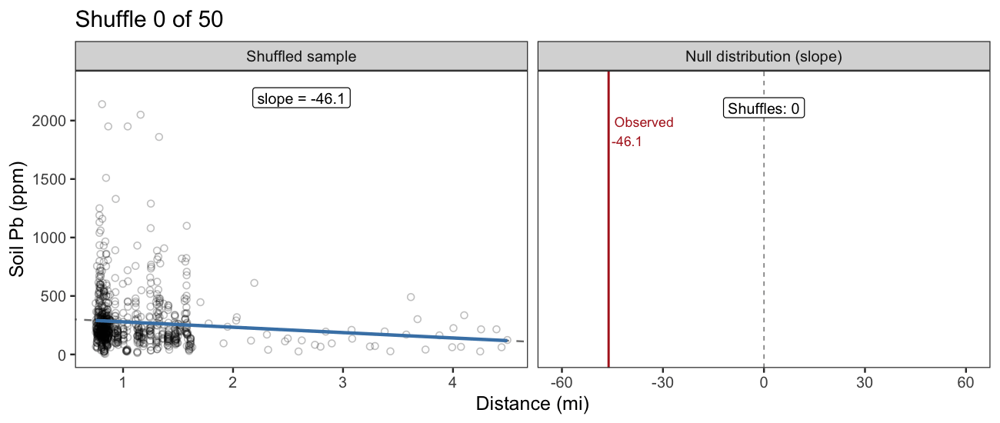
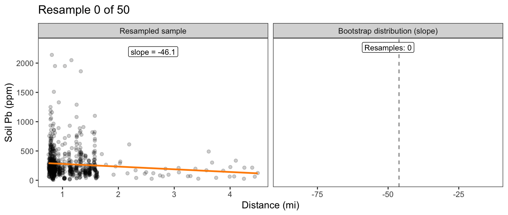

```{r}
#| label: setup
#| message: false

library(tidyverse)
library(geosphere)
set.seed(222)
theme_set(theme_bw(22))

# Approximate location of the former Exide facility (2700 S Indiana St, Vernon)
exide_lon <- -118.1923
exide_lat <- 34.0058

soil_cores <- read_csv("data/exide-soil-cores.csv") |>
  filter(location_code == "YD", pb_ppm <= 5e3) |>
  mutate(
    distance_ft = distGeo(cbind(longitude, latitude), c(exide_lon, exide_lat)) *
      3.28,
    distance_mi = distance_ft / 5280,
    bearing_deg = bearing(c(exide_lon, exide_lat), cbind(longitude, latitude))
  ) |>
  drop_na()

step_out <- read_csv("data/step-out.csv") |>
  mutate(distance_mi = distance_ft / 5280)

all_samples_north <- bind_rows(
  `soil core` = transmute(
    filter(soil_cores, between(bearing_deg, 0, 30)),
    property_id,
    distance_ft,
    distance_mi,
    pb_ppm
  ),
  `step out` = select(step_out, property_id, distance_ft, distance_mi, pb_ppm),
  .id = "source"
) |>
  drop_na()

soil_lm <- lm(pb_ppm ~ distance_mi, all_samples_north)
obs_slope <- coef(soil_lm)[["distance_mi"]]
se_slope <- coef(summary(soil_lm))["distance_mi", "Std. Error"]

# Least squares slope, without the overhead of lm()
ols_slope <- function(x, y) cov(x, y) / var(x)

# Scatter plot of soil Pb by distance with its least squares line
plot_soil <- function(samples, line_colour = "cornflowerblue") {
  slope <- ols_slope(samples$distance_mi, samples$pb_ppm)
  ggplot(samples, aes(distance_mi, pb_ppm)) +
    geom_point(shape = 21, alpha = 0.25) +
    geom_smooth(
      method = "lm",
      formula = y ~ x,
      se = FALSE,
      color = line_colour,
      linewidth = 1.5
    ) +
    coord_cartesian(ylim = c(0, max(all_samples_north$pb_ppm))) +
    labs(
      x = "Distance (mi)",
      y = "Soil Pb (ppm)",
      title = sprintf("Slope = %.1f ppm / mi", slope)
    )
}
```

# Linear regression inference

## Learning objectives

- **Apply** permutation to regression (yes/no)
- **Apply** bootstrapping to regression (how much?)
- **Interpret** mathematical models (instead of randomization)

# Apply permutation to regression

## Revisit: soil lead and distance from Exide

```{r}
#| fig-width: 7
#| fig-align: center
plot_soil(all_samples_north)
```

$$
\text{Pb (ppm)} = 325.6 - 46.1 \times \text{Distance (mi)} + \epsilon
$$

## Is the slope significantly different than 0?

The slope in our _sample_ is `r round(obs_slope, 1)` ppm / mi. But sampling is random!

**Question**: _If_ there was no relationship between soil lead and distance, _then_ how often would we observe a decline this steep?

::: {.fragment}

$H_0$: $\beta_1 = 0$ (soil Pb does not change with distance)

$H_A$: $\beta_1 < 0$ (soil Pb declines with distance)

We expect a decline: lead settles out of the air as it travels away from Exide.

:::

## Conduct a statistical experiment

Simulate the scenario in which there is no relationship. _Shuffle_ to break the link between predictor and response. 

::: {.columns}

::: {.column}

```{r}
#| fig-width: 6
plot_soil(all_samples_north) +
  labs(subtitle = "Observed")
```

:::

::: {.column}

```{r}
#| fig-width: 6
one_shuffle <- mutate(all_samples_north, distance_mi = sample(distance_mi))
plot_soil(one_shuffle, line_colour = "steelblue") +
  labs(subtitle = "Distance shuffled")
```

:::

:::

## Permutation visualized



## Compare the observed to the null statistic

```{r}
#| label: null-distribution

# Shuffle distances across soil Pb 10,000 times, recalculating the slope each
# time
null_slopes <- map_dbl(1:10000, \(i) {
  ols_slope(sample(all_samples_north$distance_mi), all_samples_north$pb_ppm)
})

# One-sided: slopes at least as steep a decline as observed
perm_pvalue <- mean(null_slopes <= obs_slope)
# The left tail is short, so no shuffle may reach the observed slope; report a
# bound instead of p = 0
perm_pvalue_label <- if (perm_pvalue == 0) {
  "< 0.0001"
} else {
  sprintf("= %.4f", perm_pvalue)
}
perm_pvalue_text <- if (perm_pvalue == 0) {
  "fewer than 1 in 10,000"
} else {
  str_glue("about {scales::percent(perm_pvalue, accuracy = 0.01)} of")
}

p_null <- tibble(slope = null_slopes) |>
  mutate(in_tail = slope <= obs_slope) |>
  ggplot(aes(slope, fill = in_tail)) +
  geom_histogram(binwidth = 4, boundary = 0, colour = "cornflowerblue") +
  geom_vline(xintercept = obs_slope, linewidth = 1) +
  scale_fill_manual(values = c(`FALSE` = "grey70", `TRUE` = "steelblue")) +
  labs(
    x = "Slope (null distribution)",
    y = "Count",
    title = str_glue("p {perm_pvalue_label}")
  ) +
  theme(legend.position = "none")

p_null
```

## Interpret the p-value

_If_ soil Pb did not change with distance from Exide, we would see a decline at least as steep as `r round(obs_slope, 1)` ppm / mi in `r perm_pvalue_text` samples.

::: {.fragment}

p < 0.05, so we reject $H_0$. The slope is _statistically significant_.

:::

::: {.fragment}

Why only the left tail? $H_A$ is $\beta_1 < 0$, so only declines count as at least as extreme. Choose the direction _before_ looking at the data!

:::

# Apply bootstrapping to regression

## How steep is the slope?

**Question**: _How much_ does soil lead decrease with each mile from Exide?

Let's reframe this as:

**Question**: What's the _interval_ that we _confidently_ think contains the population slope, $\beta_1$?

## Random to the rescue

Same procedure as Week 2: _resample_ observations with replacement.

::: {.columns}

::: {.column}

```{r}
#| fig-width: 6
plot_soil(all_samples_north) +
  labs(subtitle = "Observed")
```

:::

::: {.column}

```{r}
#| fig-width: 6
one_resample <- slice_sample(all_samples_north, prop = 1, replace = TRUE)
plot_soil(one_resample, line_colour = "darkorange") +
  labs(subtitle = "Resampled (darker = drawn more)")
```

:::

:::

## Bootstrapping visualized



## Find your _confidence interval_

```{r}
#| label: bootstrap-distribution

# Resample soil cores with replacement 10,000 times, recalculating the slope
# each time
boot_slopes <- map_dbl(1:10000, \(i) {
  resampled <- slice_sample(all_samples_north, prop = 1, replace = TRUE)
  ols_slope(resampled$distance_mi, resampled$pb_ppm)
})

boot_ci <- quantile(boot_slopes, c(0.025, 0.975))

p_ci <- tibble(slope = boot_slopes) |>
  mutate(in_ci = between(slope, boot_ci[1], boot_ci[2])) |>
  ggplot(aes(slope, fill = in_ci)) +
  geom_histogram(binwidth = 4, boundary = 0, colour = "white") +
  geom_vline(xintercept = obs_slope, linewidth = 1) +
  scale_fill_manual(values = c(`FALSE` = "grey70", `TRUE` = "darkorange")) +
  labs(
    x = "Slope (sampling distribution)",
    y = "Count",
    title = sprintf("95%% CI: [%.1f, %.1f]", boot_ci[1], boot_ci[2])
  ) +
  theme(legend.position = "none")

p_ci
```

## Interpret your confidence interval

We are 95% confident that soil Pb decreases by between `r round(-boot_ci[2], 1)` and `r round(-boot_ci[1], 1)` ppm for every mile from Exide.

::: {.fragment}

Remember what "confident" means: if we repeated this procedure many times, about 95% of the intervals would contain $\beta_1$.

:::

::: {.fragment}

Notice the CI doesn't include 0. How does that relate to the permutation test?

:::

# Interpret mathematical models

## Refresh: the normal distribution

::: {.columns}

::: {.column width="45%"}

Two parameters: the mean, $\mu$, and the standard deviation, $\sigma$

95% of the probability falls within $\mu \pm 1.96 \sigma$

Given enough independent observations, sampling distributions are approximately normal

:::

::: {.column width="55%"}

```{r}
#| fig-width: 6
std_normal <- tibble(
  z = seq(-3.5, 3.5, by = 0.01),
  density = dnorm(z)
)
ggplot(std_normal, aes(z, density)) +
  geom_area(
    data = filter(std_normal, between(z, -1.96, 1.96)),
    fill = "cornflowerblue",
    alpha = 0.25
  ) +
  geom_line() +
  geom_vline(xintercept = 0, linetype = "dashed") +
  annotate("text", x = 0, y = 0.15, label = "95%", size = 8) +
  scale_x_continuous(
    breaks = c(-1.96, 0, 1.96),
    labels = c(
      expression(mu - 1.96 * sigma),
      expression(mu),
      expression(mu + 1.96 * sigma)
    )
  ) +
  labs(x = NULL, y = "Probability density")
```

:::

:::

## The sampling distribution of a slope

The sampling distribution of $\hat \beta_1$ is approximately normal:

$$
\hat \beta_1 \sim Normal(\beta_1, SE(\hat \beta_1))
$$

- The standard deviation of the sampling distribution is the **standard error**, $SE(\hat \beta_1)$
- `lm()` estimates $SE(\hat \beta_1)$ from the residuals and the spread of the predictor

## Fit the model

::: {style="font-size:0.8em"}

```{r}
#| echo: true
#| class-output: small-output

soil_lm <- lm(pb_ppm ~ distance_mi, all_samples_north)
summary(soil_lm)
```

:::

## Reading the coefficients table

::: {style="font-size:0.8em"}

```{r}
#| class-output: small-output
coef(summary(soil_lm))
```

:::

- **Estimate**: $\hat \beta_1$, the sample statistic
- **Std. Error**: $SE(\hat \beta_1)$, the standard deviation of the sampling distribution
- **t value**: Estimate / Std. Error, how many SEs $\hat \beta_1$ is from 0
- **Pr(>|t|)**: the _two-sided_ p-value for $H_0: \beta_1 = 0$. For our one-sided $H_A$, divide by 2.

## Same SE, different means

```{r}
#| label: math-model

# One-sided, matching H_A: beta_1 < 0
math_pvalue <- pnorm(obs_slope, mean = 0, sd = se_slope)
math_ci <- obs_slope + c(-1.96, 1.96) * se_slope

# Normal density over +/- 4 SE around a center
normal_curve <- function(center) {
  tibble(
    slope = seq(center - 4 * se_slope, center + 4 * se_slope, length.out = 400),
    density = dnorm(slope, center, se_slope)
  )
}

slope_xlim <- c(
  -abs(obs_slope) - 4 * se_slope,
  abs(obs_slope) + 4 * se_slope
)
peak <- dnorm(0, sd = se_slope)

null_curve <- normal_curve(0)
p_math_null <- ggplot(null_curve, aes(slope, density)) +
  geom_area(
    data = filter(null_curve, slope <= obs_slope),
    fill = "steelblue",
    alpha = 0.5
  ) +
  geom_line() +
  geom_vline(xintercept = 0, linetype = "dashed") +
  geom_vline(xintercept = obs_slope, colour = "steelblue", linewidth = 1) +
  annotate(
    "label",
    x = 0,
    y = peak * 1.1,
    label = "H[0]: beta[1] == 0",
    parse = TRUE,
    size = 6
  ) +
  annotate(
    "label",
    x = obs_slope,
    y = peak * 0.5,
    label = "atop(Observed, hat(beta)[1])",
    parse = TRUE,
    colour = "steelblue",
    size = 5
  ) +
  coord_cartesian(xlim = slope_xlim) +
  scale_y_continuous(expand = expansion(mult = c(0.05, 0.15))) +
  labs(
    x = "Slope",
    y = "Probability density",
    title = sprintf("Normal(0, SE = %.1f)", se_slope),
    subtitle = sprintf("p = %.4f", math_pvalue)
  )

sampling_curve <- normal_curve(obs_slope)
p_math_ci <- ggplot(sampling_curve, aes(slope, density)) +
  geom_area(
    data = filter(sampling_curve, between(slope, math_ci[1], math_ci[2])),
    fill = "darkorange",
    alpha = 0.5
  ) +
  geom_line() +
  geom_vline(xintercept = obs_slope, linetype = "dashed") +
  geom_vline(xintercept = 0, colour = "grey50") +
  annotate(
    "label",
    x = obs_slope,
    y = peak * 1.1,
    label = "hat(beta)[1]",
    parse = TRUE,
    size = 6
  ) +
  annotate(
    "label",
    x = obs_slope,
    y = peak * 0.3,
    label = "hat(beta)[1] %+-% 1.96 %*% SE",
    parse = TRUE,
    colour = "darkorange",
    size = 5
  ) +
  coord_cartesian(xlim = slope_xlim) +
  scale_y_continuous(expand = expansion(mult = c(0.05, 0.15))) +
  labs(
    x = "Slope",
    y = "Probability density",
    title = sprintf("Normal(%.1f, SE = %.1f)", obs_slope, se_slope),
    subtitle = sprintf("95%% CI: [%.1f, %.1f]", math_ci[1], math_ci[2])
  )
```

::: {.columns}

::: {.column}

**p-value**: center on $H_0$

```{r}
#| fig-width: 6
#| fig-height: 5.5
p_math_null
```

:::

::: {.column}

**Confidence interval**: center on $\hat \beta_1$

```{r}
#| fig-width: 6
#| fig-height: 5.5
p_math_ci
```

:::

:::

## Randomization vs mathematical model

| | Randomization | Mathematical model |
|---|:---:|:---:|
| p-value | p `r perm_pvalue_label` (permutation) | p = `r round(math_pvalue, 4)` |
| 95% CI | [`r round(boot_ci[1], 1)`, `r round(boot_ci[2], 1)`] (bootstrap) | [`r round(math_ci[1], 1)`, `r round(math_ci[2], 1)`] |

::: {.fragment}

Same conclusion: the slope is significant and neither CI includes 0. But the exact p-value and CI differ! Why?

:::

::: {.fragment}

Both methods assume the residuals have the _same spread_ at every distance. This isn't the case with the Exide data. This model violation slightly affects the two approaches differently.

:::

## Why the intervals differ

```{r}
#| fig-width: 10
#| fig-height: 5
#| fig-align: center
all_samples_north |>
  mutate(residual = resid(soil_lm)) |>
  ggplot(aes(distance_mi, residual)) +
  geom_hline(yintercept = 0, linetype = "dashed") +
  geom_point(shape = 21, alpha = 0.25) +
  labs(x = "Distance (mi)", y = "Residual (ppm)")
```

::: {style="font-size:0.8em"}

Farther from Exide, the residuals spread out less. I.e., $\sigma$ gets smaller as distance increases. Our model doesn't allow for that, so the inferences have some bias.

$$
\begin{align}
\text{Pb (ppm)} &= \beta_0 + \beta_1 \text{Distance (mi)} + \epsilon \\
\epsilon &\sim Normal(0, \sigma)
\end{align}
$$

:::

# Recap

## What's the same

Linear regression inference is the inference you already know.

- Each sample has a **statistic**, and that statistic has a **standard error**
- Hypothesis tests still have **null distributions**, $H_0$, $H_A$, and **p-values**
- Confidence intervals still come from **sampling distributions**

## What's new

The statistic is different.

::: {.columns}

::: {.column}

**Before**

- Difference in proportions, $\hat p_1 - \hat p_2$
- Difference in means, $\bar x_1 - \bar x_2$

:::

::: {.column}

**Now**

- A coefficient, $\hat \beta_1$

:::

:::
