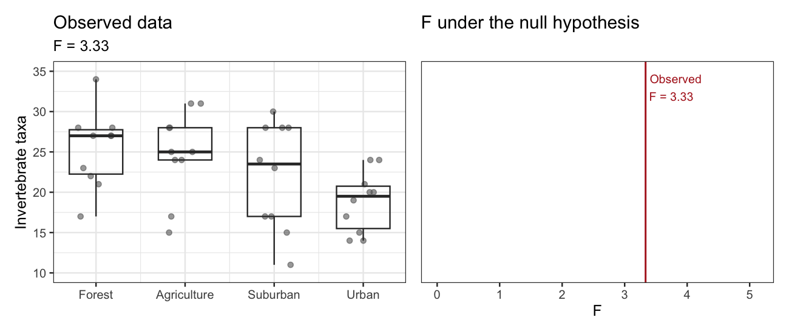

```{r}
#| label: setup
#| message: false

source("week6_wednesday_setup.R")
set.seed(222)
theme_set(theme_bw(22))

n_perm <- 5000

acid_colours <- c(
  Ambient = "steelblue",
  Moderate = "goldenrod",
  High = "firebrick"
)
acid_shapes <- c(Ambient = 16, Moderate = 17, High = 15)

# Corals with one model's fitted line for each acidification treatment
plot_corals <- function(data, model, title, subtitle = NULL) {
  lines <- expand_grid(
    temp = range(corals$temp),
    acid = factor(acid_levels, levels = acid_levels)
  ) |>
    mutate(calc = predict(model, newdata = pick(everything())))
  # Spread the labels at the right end of the lines so they don't overlap
  label_gap <- 0.22
  labels <- filter(lines, temp == max(temp)) |>
    arrange(calc) |>
    mutate(
      offset = label_gap * (row_number() - 1),
      calc = cummax(calc - offset) + offset
    )
  ggplot(data, aes(temp, calc, colour = acid)) +
    geom_point(aes(shape = acid), size = 3) +
    geom_line(aes(group = acid), lines, linewidth = 1.5) +
    geom_text(
      aes(label = acid),
      labels,
      colour = "black",
      hjust = -0.1,
      size = 6
    ) +
    scale_colour_manual(values = acid_colours, guide = "none") +
    scale_shape_manual(values = acid_shapes, guide = "none") +
    scale_x_continuous(expand = expansion(mult = c(0.05, 0.4))) +
    scale_y_continuous(limits = c(0.8, 3.2)) +
    labs(
      x = "Temperature (°C)",
      y = "Calcification\n(mg/cm²/day)",
      title = title,
      subtitle = subtitle
    )
}

stream_simple <- lm(taxa ~ 1, streams)
stream_complex <- lm(taxa ~ land_use, streams)
f_stream <- f_compare(stream_simple, stream_complex)

coral_add <- lm(calc ~ temp + acid, corals)
coral_int <- lm(calc ~ temp * acid, corals)
f_coral <- f_compare(coral_add, coral_int)
p_coral <- pf(f_coral, 2, df.residual(coral_int), lower.tail = FALSE)
```

# Model comparison

## Learning objectives

- **Derive** a p-value for the F statistic with _permutation_
- **Compare** _nested_ models with ANOVA

# From F statistic to p-value with permutation

## Does stream life differ by land use?

Invertebrate taxa counted in `r nrow(streams)` streams, 10 from each of four land uses (simulated data).

```{r}
#| fig-width: 10
#| fig-height: 5
#| fig-align: center

plot_streams(streams)
```

## Calculate the F statistic

Is `taxa ~ land_use` worth 3 more df than `taxa ~ 1`?

| Model | $p$ | $df$ | $RSS$ |
|-------|:---:|:----:|:-----:|
| `taxa ~ 1` | 1 | `r df.residual(stream_simple)` | `r round(rss(stream_simple), 1)` |
| `taxa ~ land_use` | 4 | `r df.residual(stream_complex)` | `r round(rss(stream_complex), 1)` |

$$
F = \frac{(`r round(rss(stream_simple), 1)` - `r round(rss(stream_complex), 1)`) \ / \ (4 - 1)}{`r round(rss(stream_complex), 1)` \ / \ (40 - 4)} = `r round(f_stream, 2)`
$$

::: {.fragment}

Is `r round(f_stream, 2)` surprising? We need to know what F looks like when land use doesn't matter.

:::

## What the null hypothesis says

$H_0$: every land use has the same mean number of taxa

::: {.incremental}

- If that's true, the land use labels carry no information about taxa
- So any other assignment of labels to streams was just as likely
- We can simulate $H_0$ by **shuffling the labels**

:::

## One permutation

```{r}
#| fig-width: 14
#| fig-height: 6
#| fig-align: center

set.seed(221)
one_shuffle <- shuffle_labels(streams)
f_shuffle <- f_land_use(one_shuffle)

p1 <- plot_streams(
  streams,
  "Observed",
  sprintf("F = %.2f", f_stream)
)
p2 <- plot_streams(
  one_shuffle,
  "Shuffled labels",
  sprintf("F = %.2f", f_shuffle)
)
patchwork::wrap_plots(p1, p2)
```

Every stream keeps its taxa count. Only the labels moved. Then refit both models and recalculate F.

## Now repeat



## The distribution of F under $H_0$

```{r}
#| fig-width: 12
#| fig-height: 5
#| fig-align: center

set.seed(222)
f_null <- map_dbl(seq_len(n_perm), \(i) f_land_use(shuffle_labels(streams)))
p_stream <- mean(f_null >= f_stream)
p_stream_math <- pf(f_stream, 3, 36, lower.tail = FALSE)

# Bins start at 0 and break exactly at the observed F
stream_bin <- f_stream / 16
# F density scaled to match the histogram's counts
stream_curve <- tibble(f = seq(0.01, 8, by = 0.01)) |>
  mutate(shuffles = df(f, 3, 36) * n_perm * stream_bin)

ggplot(tibble(f = f_null), aes(f, fill = f >= f_stream)) +
  geom_histogram(binwidth = stream_bin, boundary = f_stream) +
  geom_line(
    aes(f, shuffles),
    stream_curve,
    linewidth = 1,
    inherit.aes = FALSE
  ) +
  geom_vline(xintercept = f_stream, linewidth = 1) +
  annotate(
    "text",
    x = f_stream + 0.1,
    y = 400,
    hjust = 0,
    label = "Curve: F distribution",
    size = 7
  ) +
  annotate(
    "text",
    x = f_stream + 0.1,
    y = Inf,
    vjust = 2,
    hjust = 0,
    label = sprintf("Observed F = %.2f", f_stream),
    size = 7
  ) +
  annotate(
    "text",
    x = f_stream + 0.3,
    y = 90,
    hjust = 0,
    label = sprintf("%s of shuffles", scales::percent(p_stream, 0.1)),
    colour = "firebrick",
    size = 7
  ) +
  scale_fill_manual(
    values = c(`FALSE` = "grey70", `TRUE` = "firebrick"),
    guide = "none"
  ) +
  coord_cartesian(xlim = c(0, 8)) +
  labs(
    x = "F",
    y = "Shuffles",
    title = sprintf(
      "Permutation p = %.3f    F distribution p = %.3f",
      p_stream,
      p_stream_math
    )
  )
```

## Interpret the permutation test

_If_ land use had no relationship with taxa, we'd see an F at least this large in `r scales::percent(p_stream, 0.1)` of shuffles. Reject $H_0$ at $\alpha = 0.05$.

::: {.fragment}

We have evidence that at least one land use differs from the others.

:::

# Compare nested models with ANOVA

## Warming and acidification

Coral calcification across temperature in `r nrow(corals)` tanks, 15 from each of three acidification treatments (simulated data).

```{r}
#| fig-width: 12
#| fig-height: 5
#| fig-align: center

patchwork::wrap_plots(
  plot_corals(corals, coral_add, "Additive", "calc ~ temp + acid"),
  plot_corals(corals, coral_int, "Interactive", "calc ~ temp * acid")
)
```

::: {.fragment}

Which model has stronger evidence?

:::

## Nested models

Model A is **nested** in model B if setting some of B's coefficients to 0 gives you A.

::: {.fragment style="font-size:0.8em"}

$$
\begin{align}
\text{Additive: } \text{calc} &= \beta_0 + \beta_1 \text{temp} + \beta_2 (\text{Moderate}) + \beta_3 (\text{High}) + \epsilon \\
\text{Interactive: } \text{calc} &= \beta_0 + \beta_1 \text{temp} + \beta_2 (\text{Moderate}) + \beta_3 (\text{High}) \\
&\quad + \beta_4 (\text{temp} \times \text{Moderate}) + \beta_5 (\text{temp} \times \text{High}) + \epsilon
\end{align}
$$

:::

::: {.incremental}

- Set $\beta_4 = \beta_5 = 0$ and you get the additive model
- The difference is the **interaction term**, which costs 2 df: one extra slope for each non-reference level
- ANOVA tests nested models: $H_0$ says the extra coefficients are 0

:::

## What isn't nested?

`calc ~ temp` and `calc ~ acid`

::: {.incremental}

- Neither one is the other with a coefficient set to 0
- There's no "extra" coefficient for $H_0$ to set to 0
- ANOVA can't compare them

:::

::: {.fragment}

Both _are_ nested in `calc ~ temp + acid`, and ANOVA can compare either one to that model.

:::

## Calculate the F statistic

$H_0$: $\beta_4 = \beta_5 = 0$ (no interaction) $\qquad$ $H_A$: at least one $\neq 0$

| Model | $p$ | $df$ | $RSS$ |
|-------|:---:|:----:|:-----:|
| `calc ~ temp + acid` | 4 | `r df.residual(coral_add)` | `r round(rss(coral_add), 2)` |
| `calc ~ temp * acid` | 6 | `r df.residual(coral_int)` | `r round(rss(coral_int), 2)` |

::: {style="font-size:0.8em"}

```{r}
#| echo: true
#| class-output: small-output

anova(lm(calc ~ temp + acid, corals), lm(calc ~ temp * acid, corals))
```

:::

## The F distribution

If $H_0$ is true, $F$ follows an **F distribution**.

```{r}
#| fig-width: 12
#| fig-height: 5
#| fig-align: center

f_dist <- tibble(f = seq(0.01, 8, by = 0.01)) |>
  mutate(density = df(f, 2, df.residual(coral_int)))

ggplot(f_dist, aes(f, density)) +
  geom_area(
    data = filter(f_dist, f >= f_coral),
    fill = "firebrick",
    alpha = 0.6
  ) +
  geom_line(linewidth = 1) +
  geom_vline(xintercept = f_coral, linewidth = 1) +
  annotate(
    "text",
    x = f_coral + 0.1,
    y = 0.9,
    label = sprintf("Observed F = %.2f", f_coral),
    hjust = 0,
    size = 7
  ) +
  coord_cartesian(ylim = c(0, 1)) +
  labs(
    x = "Null distribution of F",
    y = NULL,
    title = sprintf("p = %.2f", p_coral)
  ) +
  theme(axis.text.y = element_blank(), axis.ticks.y = element_blank())
```

## Interpret the ANOVA

_If_ there were no interaction, we'd see an F at least this large in about `r scales::percent(p_coral, 1)` of samples. Fail to reject $H_0$.

::: {.fragment}

We do not find evidence supporting an interaction between temperature and acidification.

:::

::: {.fragment}

That isn't evidence that there is _no_ interaction. These data just don't show one clearly.

:::

## What happens next: option 1

**Proceed with the additive model.**

This is the **parsimony principle**: in the absence of evidence for a more complex model, a simpler model is preferred.

```{r}
#| fig-width: 10
#| fig-height: 5
#| fig-align: center

plot_corals(corals, coral_add, "Additive", "calc ~ temp + acid")
```

## What happens next: option 2

_If_ there is strong independent evidence that the interaction matters, **keep it in your model**.

```{r}
#| fig-width: 10
#| fig-height: 5
#| fig-align: center

plot_corals(corals, coral_int, "Interactive", "calc ~ temp * acid")
```

# Recap

## The F statistic

The **F statistic** says how much your model improved, relative to the df spent. 

::: {.incremental}

- Use the F statistic to test the hypothesis that a **more complex** model explains the data better than a **simpler** model.
- The **null distribution** of F describes the F statistics expected by chance alone.
- Compare the observed F to the null distribution to get your p-value, and interpret accordingly.

:::

## Model comparison

Use ANOVA to compare models that are **nested** and differ by **more than one parameter**.

::: {.incremental}

- Nested models contain a subset of parameters of complex models. 
- If the difference is one parameter, ANOVA isn't necessary.
- Remember: _absence of evidence is not evidence of absence_. A more complex model may be preferable when ANOVA is not significant, if there's independent evidence.

:::
